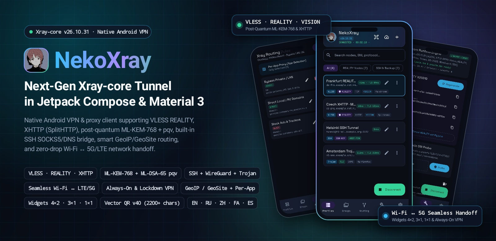
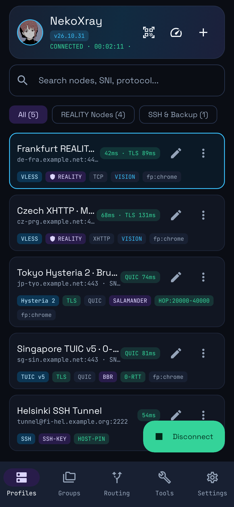
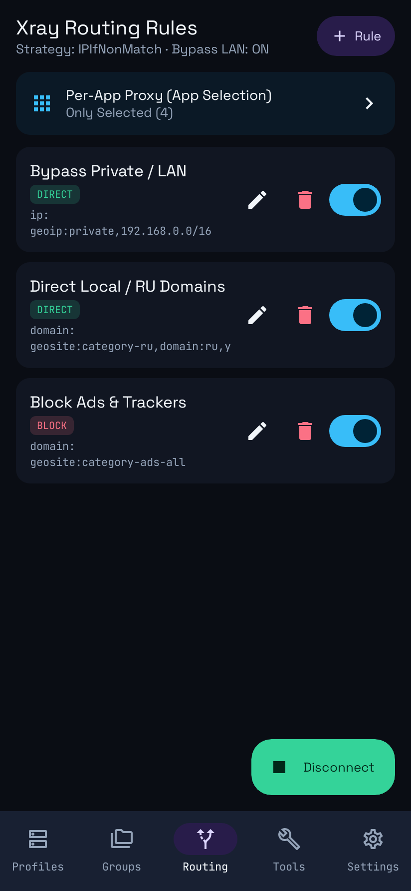
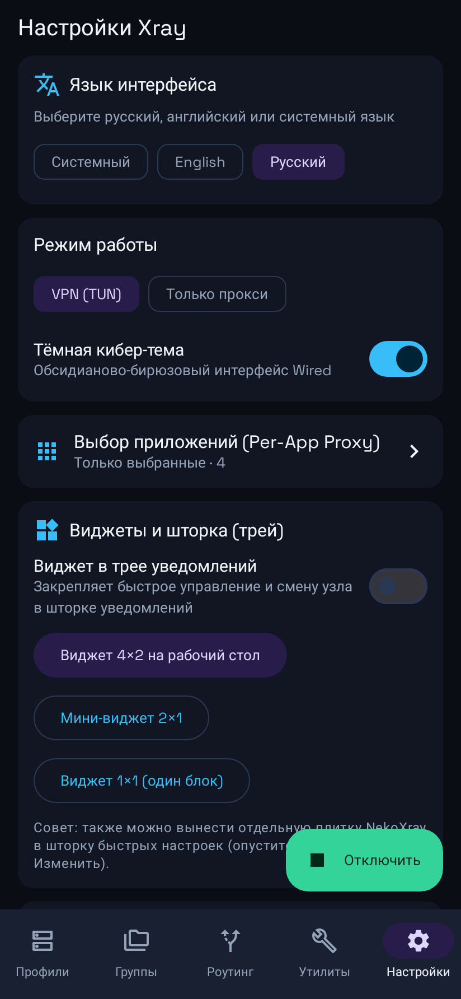
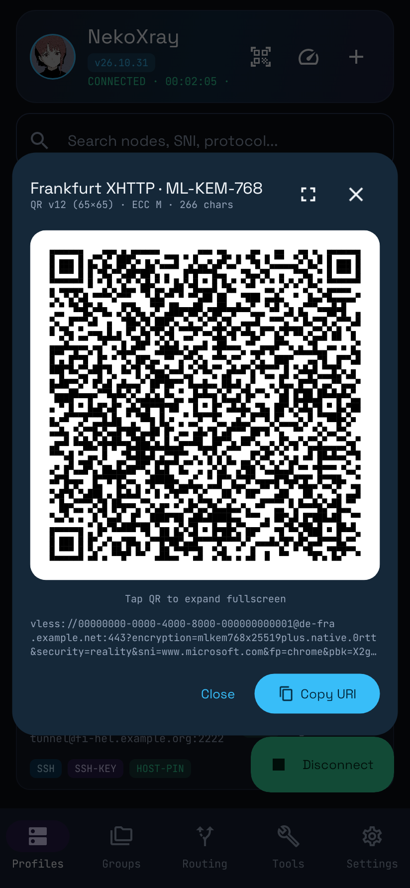
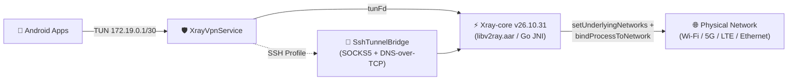

<div align="center">



# NekoXray

### Modern Android Xray-core (`v26.10.31`) VPN & Proxy Client in Jetpack Compose & Material 3

[**🇬🇧 English**](README.md) · [**🇷🇺 Русский**](README_RU.md)

[-3DDC84?style=for-the-badge&logo=android&logoColor=white)](#)
[](#)
[](#)
[](#)
[](#)
[](LICENSE)

<p align="center">
  <a href="#-highlights">Highlights</a> •
  <a href="#-supported-protocols--transports">Protocols</a> •
  <a href="#-screenshots">Screenshots</a> •
  <a href="#-network-resilience--always-on-vpn">Network Engine</a> •
  <a href="#-architecture">Architecture</a> •
  <a href="#-building-from-source">Build & CI</a> •
  <a href="#-license">License</a>
</p>

</div>

---

**NekoXray** is a clean-room Android VPN and proxy client built from the ground up with **Kotlin**, **Jetpack Compose**, and **Material Design 3**, powered by native **Xray-core (`AndroidLibXrayLite` / `libv2ray.aar` v26.10.31)**. Crafted around a high-contrast **Wired Cyber** dark aesthetic, it combines post-quantum **VLESS REALITY + XHTTP**, **SSH tunneling**, **smart GeoIP/GeoSite routing**, **seamless Wi-Fi ↔ LTE/5G handoff**, and **Android Always-On / Lockdown VPN** support in a responsive UI for phones, foldables, and tablets.

---

## ✨ Highlights

<table>
  <tr>
    <td width="50%" valign="top">
      <h3>🛡️ Next-Gen Censorship Resistance</h3>
      <ul>
        <li><b>VLESS REALITY & XHTTP (SplitHTTP)</b> with <code>packet-up</code>, <code>stream-up</code>, <code>stream-one</code>, <code>auto</code> modes and custom JSON <code>extra</code> padding/limits.</li>
        <li><b>Post-Quantum Cryptography:</b> Full support for <code>mlkem768x25519plus</code> encryption and <code>pqv</code> (<b>ML-DSA-65</b>) server signature verification.</li>
        <li><b>TLS Hello Fragment</b> & uTLS browser fingerprint spoofing (<code>chrome</code>, <code>firefox</code>, <code>safari</code>, <code>ios</code>, <code>android</code>, <code>edge</code>, <code>qq</code>, <code>random</code>).</li>
      </ul>
    </td>
    <td width="50%" valign="top">
      <h3>📶 Seamless Wi-Fi ↔ LTE/5G Handoff</h3>
      <ul>
        <li><b>Physical Network Tracking:</b> Real-time <code>ConnectivityManager</code> monitoring of validated physical transports (Wi-Fi, Cellular 5G/LTE, Ethernet) with <code>LinkProperties</code> IP & DNS readiness checks.</li>
        <li><b>Zero-Drop Rebinding:</b> Automatically updates <code>setUnderlyingNetworks()</code>, binds the VPN process and outbound sockets to the active physical interface, and performs non-cancellable TUN handoffs.</li>
        <li><b>Always-On & Lockdown Ready:</b> Full support for Android system <i>Always-On VPN</i> and <i>Block connections without VPN</i>.</li>
      </ul>
    </td>
  </tr>
  <tr>
    <td width="50%" valign="top">
      <h3>🧭 Smart Routing & Per-App Proxy</h3>
      <ul>
        <li><b>Pre-Bundled Geo Assets:</b> Gradle automatically provisions <code>geoip.dat</code> and <code>geosite.dat</code> at build time, with automatic extraction on first launch and safe CIDR/domain fallback.</li>
        <li><b>Granular Rules:</b> Route by domain (<code>geosite:</code>, <code>domain:</code>, wildcards), IP/CIDR (<code>geoip:</code>), port, or protocol to <code>PROXY</code>, <code>DIRECT</code>, or <code>BLOCK</code>.</li>
        <li><b>Per-App VPN:</b> Choose <i>All Apps</i>, <i>Only Selected</i>, or <i>Bypass Selected</i> with one-tap <b>NekoBox clipboard list import/export</b> (<code>false</code>/<code>true</code> header + package IDs).</li>
      </ul>
    </td>
    <td width="50%" valign="top">
      <h3>🧩 Widgets, QR & Built-in Utilities</h3>
      <ul>
        <li><b>3 Homescreen Widgets + Quick Settings:</b> <code>4×2</code> Status Dashboard, <code>3×1</code> Compact Bar, <code>1×1</code> Mini Toggle, persistent Notification Tray bar, and QS Tile.</li>
        <li><b>Ultra-Dense Vector QR:</b> Encodes and scans <b>2200+ char</b> ML-KEM-768 VLESS URIs (up to QR Version 40, ECC-L) via CameraX or zero-permission Android Photo Picker.</li>
        <li><b>REALITY Toolkit:</b> Built-in X25519 keypair + UUID + Short ID generator with ready-to-copy server <code>config.json</code> and live <code>TLSv1.3 / H2</code> SNI probe.</li>
      </ul>
    </td>
  </tr>
</table>

---

## 🌐 Supported Protocols & Transports

| Protocol | Transports | Security / Auth | Key Capabilities |
| :--- | :--- | :--- | :--- |
| **VLESS** | `TCP`, `XHTTP` (`SplitHTTP`), `WS`, `gRPC`, `HTTPUpgrade`, `KCP` | `REALITY`, `TLS`, `None` | `xtls-rprx-vision`, `mlkem768x25519plus` (0-RTT), `pqv` (`ML-DSA-65`), `xhttpSettings.extra` |
| **VMess** | `TCP`, `WS`, `gRPC`, `HTTPUpgrade`, `XHTTP`, `KCP` | `TLS`, `None` | AEAD encryption (`auto`, `aes-128-gcm`, `chacha20-poly1305`, `none`) |
| **Trojan** | `TCP`, `WS`, `gRPC`, `XHTTP` | `TLS`, `REALITY` | uTLS fingerprint spoofing, ALPN (`h2`, `http/1.1`), SNI override |
| **Shadowsocks** | `TCP` + `UDP` | `2022-blake3-*`, AEAD ciphers | `2022-blake3-aes-128-gcm`, `2022-blake3-aes-256-gcm`, `2022-blake3-chacha20-poly1305`, `aes-256-gcm`, `chacha20-ietf-poly1305` |
| **WireGuard** | Native `UDP` tunnel | Curve25519 Keypair + Pre-Shared Key | Custom Peer Endpoint, Reserved bytes (`[b0, b1, b2]`), Local CIDR & MTU |
| **SSH Tunnel** | `TCP` (`mwiede/jsch`) | Password, PEM / OpenSSH Private Key (+ passphrase) | Embedded local SOCKS5 TCP + **DNS-over-TCP (`UDP ASSOCIATE`)** bridge & Host Public Key pinning |
| **SOCKS5 / HTTP** | `TCP` | Optional Username / Password | Standard outbound proxy chaining & clean URI distinction from subscription URLs |
| **Custom JSON** | Any Xray-core inbound/outbound | Full Xray `v26.10.31` schema | Raw `config.json` editor with syntax validation & live TUN injection |

> **Subscriptions Supported:** Standard Base64 / plaintext node feeds, `https://.../sub/...`, `sub://`, `v2rayng://install-sub`, `clash://install-config`, and `happ://add/...` links.

---

## 📱 Screenshots

<div align="center">

| Profiles & REALITY Nodes | Routing & Per-App Proxy | REALITY Keygen & SNI Probe |
| :---: | :---: | :---: |
|  |  |  |
| *Live speed telemetry, node ping & Reality badges* | *GeoSite/GeoIP rules & NekoBox Per-App list sync* | *X25519 keygen, server JSON & TLSv1.3 SNI probe* |

| Multi-Language Settings (6 Locales) | High-Density Vector QR Share |
| :---: | :---: |
|  |  |
| *Instant switching: EN, RU, ZH-CN, ZH-TW, FA (RTL), ES* | *Crisp vector QR up to v40 (2200+ char PQC URIs)* |

</div>

---

## 🔄 Network Resilience & Always-On VPN

Mobile networks frequently transition between Wi-Fi and Cellular (LTE/5G). NekoXray implements a dedicated physical network state machine in `XrayVpnService`:

1. **Physical Transport Ranking:** Filters out virtual VPN interfaces (`NET_CAPABILITY_NOT_VPN` + `!TRANSPORT_VPN`) and ranks candidates by `NET_CAPABILITY_VALIDATED`, usable `LinkProperties` IPv4/IPv6 addresses, OS default network status, and transport priority (`Ethernet > Wi-Fi > Cellular > Bluetooth`).
2. **Process & Socket Binding:** Calls `VpnService.setUnderlyingNetworks(...)` and `ConnectivityManager.bindProcessToNetwork(...)` while protecting (`VpnService.protect(socket)`) and binding Kotlin/SSH sockets directly to the active physical `Network`.
3. **Deadlock-Free TUN Handoff:** Serializes network transitions with generation tokens and bounded mutex timeouts (`800ms` on stop, `2500ms` on start/handoff) inside `NonCancellable` blocks with full `ParcelFileDescriptor` tracking — ensuring the system VPN never hangs or leaks `/dev/net/tun` descriptors even during rapid Wi-Fi ↔ LTE flapping.
4. **System Always-On & Lockdown:** Declares `android.net.VpnService.SUPPORTS_ALWAYS_ON = true` and automatically bootstraps the selected profile from Room + DataStore when started by Android OS in the background.

---

## 🏗️ Architecture



```text
app/src/main/java/com/example/
├── core/
│   ├── crypto/    # X25519 REALITY keygen, shortId & UUID utilities
│   ├── model/     # ProxyProfile, ProxyGroup, RoutingRule, XraySettings, AppLanguage
│   ├── network/   # TLSv1.3 / H2 SNI probe, TCP/TLS latency tester, subscription fetcher
│   ├── parser/    # URI parser & exporter (vless/vmess/trojan/ss/wg/ssh/socks/http/json + subs)
│   ├── vpn/       # XrayVpnService, XrayTileService, SshTunnelBridge, KotlinTunForwarder
│   ├── widget/    # 4x2 Status, 3x1 Compact, 1x1 Mini AppWidgets & Tray Notification controller
│   └── xray/      # XrayConfigBuilder, XrayAssetHelper (.dat provisioning) & validator
├── data/          # Room database (KSP), DataStore Preferences, NekoRepository
└── ui/            # Jetpack Compose M3 screens, adaptive Navigation, 6-locale i18n, Wired theme
```

| Layer | Technology |
| :--- | :--- |
| **UI & Design System** | Jetpack Compose, Material Design 3, Adaptive `NavigationBar` / `NavigationRail`, Custom Vector Canvas QR |
| **Core Proxy Engine** | `AndroidLibXrayLite` (`libv2ray.aar` `v26.10.31`), `mwiede/jsch` (`0.2.21`) for SSH tunneling |
| **Geo Routing Data** | Auto-downloaded `geoip.dat` & `geosite.dat` (`v2fly`) + `XrayAssetHelper` runtime verification |
| **Persistence** | Room (`2.7.0-alpha11` with KSP) + Jetpack DataStore Preferences + `kotlinx.serialization` |
| **Camera & Media** | CameraX (`1.5.0`) + ZXing (`3.5.3`) + zero-permission `PickVisualMedia` Photo Picker |
| **Quality & Testing** | JUnit 4 + Robolectric (`@GraphicsMode(NATIVE)` screenshot tests + 29 unit/integration tests) |

---

## 🛠️ Building from Source

During `preBuild`, `app/build.gradle.kts` automatically downloads:
- `app/libs/libv2ray.aar` (`2dust/AndroidLibXrayLite` `v26.10.31`) via `:app:downloadLibv2ray`
- `app/src/main/assets/geoip.dat` & `geosite.dat` via `:app:downloadGeoAssets`

```bash
# 1. Build universal debug APK
gradle assembleDebug

# 2. Build per-ABI split APKs (arm64-v8a, armeabi-v7a, x86_64, x86 + universal)
gradle assembleDebug -PenableAbiSplits=true

# 3. Build signed multi-ABI release APKs & Android App Bundle (.aab)
gradle assembleRelease bundleRelease -PenableAbiSplits=true

# 4. Run the full unit & Robolectric test suite (29 tests)
gradle :app:testDebugUnitTest --console=plain
```

### 📦 Multi-ABI Release Artifacts

| Artifact | Target Architecture | Recommended For |
| :--- | :--- | :--- |
| `NekoXray-<tag>-arm64-v8a.apk` | 64-bit ARM (`aarch64`) | **Most modern Android phones & tablets (Recommended)** |
| `NekoXray-<tag>-armeabi-v7a.apk` | 32-bit ARM (`armv7l`) | Legacy 32-bit Android devices & Android TV boxes |
| `NekoXray-<tag>-x86_64.apk` | 64-bit x86 (`amd64`) | ChromeOS, Android Studio emulators, x86_64 tablets |
| `NekoXray-<tag>-x86.apk` | 32-bit x86 (`i686`) | Legacy x86 emulators |
| `NekoXray-<tag>-universal.apk` | All ABIs bundled | Universal fallback installer |
| `NekoXray-<tag>.aab` | Play App Bundle | Google Play / Play Creator Program distribution |

<details>
<summary><b>🔐 Automated GitHub Releases & GitHub Pages Landing Site (Click to expand)</b></summary>

<br/>

#### GitHub Actions Release Pipeline
Push a version tag (`v*`, e.g. `v1.0.0`) or trigger **Release Multi-ABI APKs** manually in GitHub Actions to run all tests, build per-ABI APKs, generate `SHA256SUMS.txt`, and publish a GitHub Release.

To sign release builds with your own upload key (`alias: upload`), configure these **GitHub Repository Secrets**:
- `RELEASE_KEYSTORE_BASE64`
- `RELEASE_STORE_PASSWORD`
- `RELEASE_KEY_PASSWORD`

#### Bilingual Download Landing Page (`docs/index.html`)
The `docs/` folder contains a zero-dependency landing page that queries the GitHub Releases API, detects the visitor's Android CPU architecture, displays `SHA256SUMS.txt`, and supports instant **EN / RU** toggling. Enable it under **Settings → Pages → Source: GitHub Actions** (`.github/workflows/pages.yml`).

</details>

---

## ⚖️ License

**NekoXray** source code is dual-licensed under **`MIT OR LGPL-3.0-or-later`** — you may choose either license at your option (see [`LICENSE`](LICENSE)).

| Component | License | Reference |
| :--- | :--- | :--- |
| **NekoXray Application Source Code** | `MIT OR LGPL-3.0-or-later` | [`LICENSE`](LICENSE) |
| **AndroidLibXrayLite (`libv2ray.aar`)** | `LGPL-3.0` | [`COPYING.LESSER`](COPYING.LESSER) · [`COPYING`](COPYING) · [2dust/AndroidLibXrayLite](https://github.com/2dust/AndroidLibXrayLite) |
| **Xray-core (bundled in `libv2ray.aar`)** | `MPL-2.0` | [XTLS/Xray-core](https://github.com/XTLS/Xray-core) |
| **JSch (`com.github.mwiede:jsch`)** | `BSD-style` | [mwiede/jsch](https://github.com/mwiede/jsch) |
| **Third-Party Notices & Attributions** | Various Permissive / Weak Copyleft | [`THIRD-PARTY-LICENSES.md`](THIRD-PARTY-LICENSES.md) |

> **LGPL-3.0 Section 4 Compliance & Clean-Room Notice:** Prebuilt APK/AAB releases dynamically link `AndroidLibXrayLite` (`libv2ray.aar`). Complete Gradle build scripts and source code are provided in this repository so any user can replace `app/libs/libv2ray.aar` with a modified build and reassemble the application (`gradle assembleDebug`). NekoXray implements clean-room compatibility with NekoBox URI/clipboard formats and contains no GPL-3.0 code.
