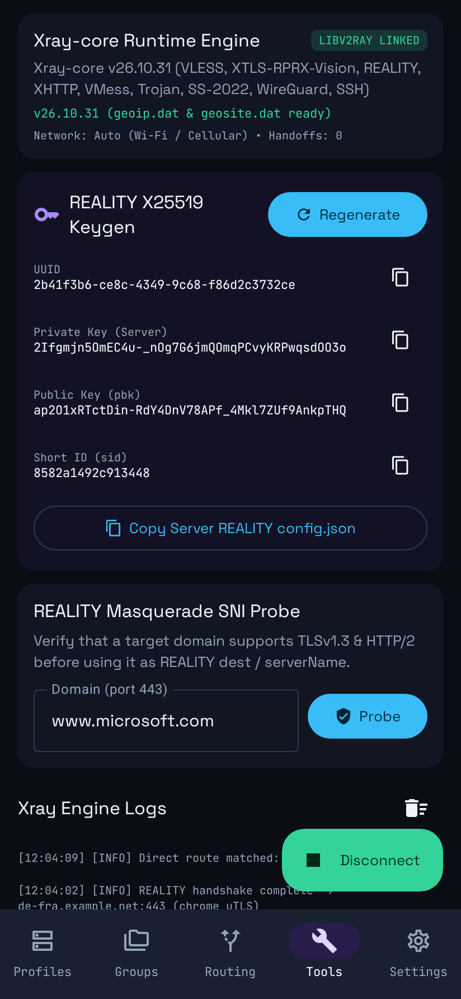

<div align="center">


# NekoXray

**Modern Android Xray-core (`v26.10.31`) client in Jetpack Compose & Material 3**

[English](README.md) · [Русский](README_RU.md)

-3DDC84?style=flat-square&logo=android&logoColor=white)


</div>

---

**NekoXray** is an Android proxy and VPN client built from the ground up with **Kotlin**, **Jetpack Compose**, and **Material Design 3**, powered by native **Xray-core (`AndroidLibXrayLite` / `libv2ray.aar`)**. Designed with a dark cyber-minimalist **Wired** palette, it brings modern censorship-resistant transports, SSH tunneling, smart routing, and NekoBox compatibility together in a clean mobile & tablet UI.

## Key Features

- **Modern Protocols & Transports**
  - **VLESS** with `xtls-rprx-vision`, **REALITY**, **XHTTP (SplitHTTP)**, and post-quantum **ML-KEM-768** + `pqv` (ML-DSA-65) verification
  - **VMess**, **Trojan**, **Shadowsocks (2022)**, **WireGuard**, **SOCKS5**, **HTTP**, and **Custom Xray JSON**
  - **SSH Tunneling** via `mwiede/jsch` with an embedded SOCKS5 TCP & DNS-over-TCP relay bridge (supports Password, PEM/OpenSSH Private Key + passphrase, and Host Public Key pinning)
- **Routing Engine & Per-App Proxy**
  - Domain (`geosite:`, `domain:`, wildcards), IP/CIDR (`geoip:`), port, and protocol routing rules with `PROXY` / `DIRECT` / `BLOCK` actions
  - **Per-App Proxy** (`All Apps`, `Only Selected`, `Bypass Selected`) with **NekoBox clipboard list import/export** (`false`/`true` header + package list)
  - Optional **TLS Hello Fragment** anti-DPI protection, custom remote DoH/DNS & direct DNS, and IPv6 routing strategies
- **QR Sharing & Live Scanner**
  - High-density **Vector Canvas QR generator** supporting **2200+ char** VLESS ML-KEM-768 URIs (up to QR Version 40, auto ECC-L) with one-tap fullscreen view
  - Built-in **CameraX + ZXing** QR scanner with flashlight toggle and zero-permission **Android Photo Picker** gallery decoding
- **Built-in REALITY Utilities**
  - Instant **X25519 keypair + UUID + Short ID** generator with ready-to-copy server `config.json`
  - **REALITY Masquerade SNI Probe** to verify `TLSv1.3` and `HTTP/2` compatibility before deployment
- **Adaptive UI, Live Stats & Bilingual Support**
  - Instant in-app language switching (**System**, **English**, **Русский**) without restarting or dropping the active VPN tunnel
  - Live foreground notification with upload/download speed & session counters, plus Android Quick Settings tile
  - Adaptive navigation (`NavigationBar` on phones, `NavigationRail` on tablets/foldables)

---

## Screenshots

<div align="center">

| Profiles & REALITY Nodes | Routing & Per-App Proxy | REALITY Keygen & SNI Probe |
| :---: | :---: | :---: |
|  |  |  |

| Russian UI & Language Selector | Full-Width Vector QR Share |
| :---: | :---: |
|  |  |

</div>

---

## Architecture & Tech Stack

```text
app/src/main/java/com/example/
├── core/
│   ├── crypto/    # X25519 REALITY keygen & UUID utilities
│   ├── model/     # ProxyProfile, ProxyGroup, RoutingRule, XraySettings, AppLanguage
│   ├── network/   # TLSv1.3 SNI probe, latency tester, subscription fetcher
│   ├── parser/    # URI parser & exporter (vless/vmess/trojan/ss/wg/ssh/socks/json)
│   ├── vpn/       # XrayVpnService, XrayTileService, SshTunnelBridge, KotlinTunForwarder
│   └── xray/      # XrayConfigBuilder & profile validator
├── data/          # Room entities/DAOs, DataStore preferences, NekoRepository
└── ui/            # Jetpack Compose M3 screens, Navigation, i18n, Wired Cyber theme
```

- **UI:** Jetpack Compose, Material 3, Navigation Compose (type-safe `@Serializable` routes)
- **Core:** `AndroidLibXrayLite` (`libv2ray.aar` v26.10.31), `mwiede/jsch` for SSH
- **Persistence:** Room (KSP) + Jetpack DataStore Preferences
- **Camera & QR:** CameraX `1.5.0` + ZXing `3.5.3` + Android Photo Picker
- **Testing:** JUnit 4 + Robolectric (`@GraphicsMode(NATIVE)` UI screenshot tests + unit tests)

---

## Building from Source & Multi-ABI Releases

`app/build.gradle.kts` automatically downloads `libv2ray.aar` (`v26.10.31`) during `preBuild`.

```bash
# Build standard universal debug APK
gradle assembleDebug

# Build per-architecture APKs (arm64-v8a, armeabi-v7a, x86, x86_64 + universal)
gradle assembleDebug -PenableAbiSplits=true

# Build signed multi-ABI release APKs & App Bundle
gradle assembleRelease bundleRelease -PenableAbiSplits=true

# Run unit & Robolectric tests
gradle :app:testDebugUnitTest
```

### Automated GitHub Releases

Push a tag (`v*`, e.g. `v1.0.0`) or run the **Release Multi-ABI APKs** workflow manually in GitHub Actions to automatically build, verify checksums (`SHA256SUMS.txt`), and publish a GitHub Release with:

- `NekoXray-<tag>-arm64-v8a.apk` (Modern 64-bit ARM devices — recommended)
- `NekoXray-<tag>-armeabi-v7a.apk` (32-bit ARM devices)
- `NekoXray-<tag>-x86_64.apk` / `x86.apk` (Emulators & x86 tablets)
- `NekoXray-<tag>-universal.apk` & `NekoXray-<tag>.aab`

> To sign releases with your persistent upload key, add `RELEASE_KEYSTORE_BASE64`, `RELEASE_STORE_PASSWORD`, and `RELEASE_KEY_PASSWORD` (`alias: upload`) in **GitHub Repository Secrets**.
>
> **Note:** On Android 14+, the app uses `FOREGROUND_SERVICE_SPECIAL_USE` (`vpn`) for the system VPN tunnel and requests `CAMERA` permission only when opening the live QR scanner (image gallery scanning requires no storage permissions).

### Download Landing Page (GitHub Pages)

The `docs/` directory includes a single-page landing website (`docs/index.html`) that automatically fetches the latest release from GitHub Releases, detects the visitor's Android CPU ABI (`arm64-v8a`, `armeabi-v7a`, `x86_64`, `x86`, `universal`), displays release notes & `SHA256SUMS.txt`, and supports instant **EN / RU** switching.

To publish it on GitHub Pages: open **Settings → Pages → Build and deployment → Source: GitHub Actions** (handled automatically by `.github/workflows/pages.yml`), or select **Deploy from a branch → `/docs`**.
