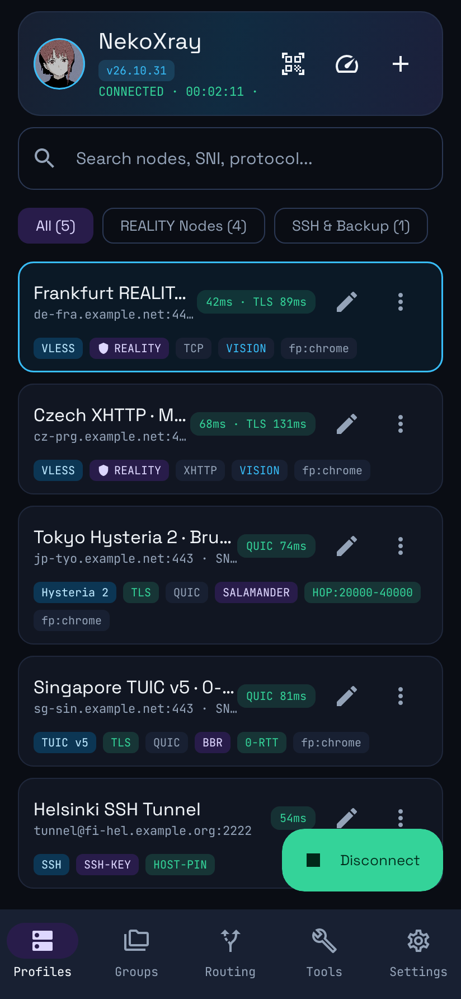
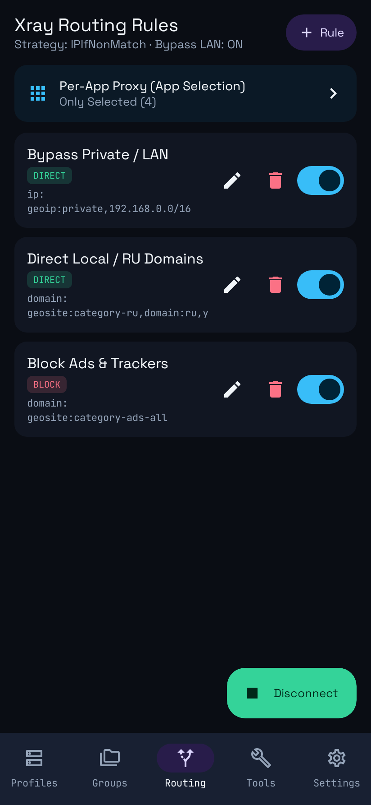
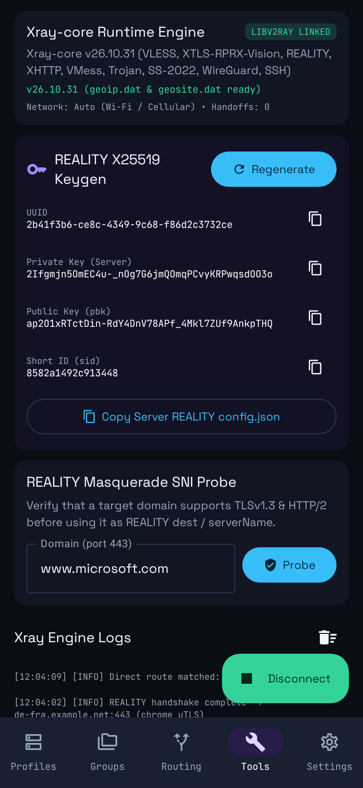
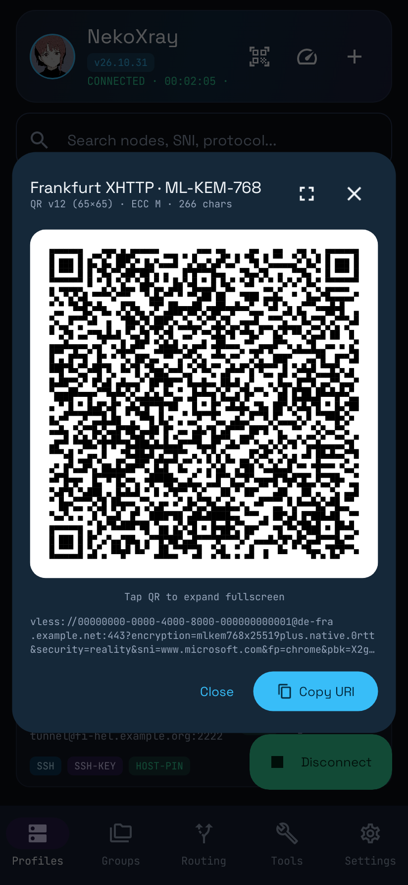
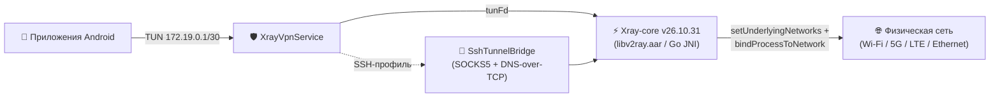

<div align="center">


# NekoXray

### Современный Android VPN и прокси-клиент на базе Xray-core (`v26.10.31`) на Jetpack Compose & Material 3

[**🇬🇧 English**](README.md) · [**🇷🇺 Русский**](README_RU.md)

[-3DDC84?style=for-the-badge&logo=android&logoColor=white)](#)
[](#)
[](#)
[](#)
[](#)
[](LICENSE)

<p align="center">
  <a href="#-ключевые-возможности">Возможности</a> •
  <a href="#-поддерживаемые-протоколы-и-транспорты">Протоколы</a> •
  <a href="#-скриншоты">Скриншоты</a> •
  <a href="#-бесшовное-переключение-сетей-и-always-on-vpn">Сеть и Always-On</a> •
  <a href="#-архитектура-проекта">Архитектура</a> •
  <a href="#-сборка-из-исходников">Сборка и CI</a> •
  <a href="#-лицензия">Лицензия</a>
</p>

</div>

---

**NekoXray** — современный прокси и VPN-клиент для Android, написанный с нуля на **Kotlin**, **Jetpack Compose** и **Material Design 3** поверх нативного ядра **Xray-core (`AndroidLibXrayLite` / `libv2ray.aar` v26.10.31)**. Выполненный в контрастной кибер-минималистичной теме **Wired Cyber**, клиент объединяет постквантовый **VLESS REALITY + XHTTP**, **SSH-туннелирование**, **умную маршрутизацию GeoIP/GeoSite**, **бесшовное переключение Wi-Fi ↔ LTE/5G** и поддержку системного режима **Always-On / Lockdown VPN**.

---

## ✨ Ключевые возможности

<table>
  <tr>
    <td width="50%" valign="top">
      <h3>🛡️ Современные транспорты и PQC-защита</h3>
      <ul>
        <li><b>VLESS REALITY & XHTTP (SplitHTTP)</b> с режимами <code>packet-up</code>, <code>stream-up</code>, <code>stream-one</code>, <code>auto</code> и кастомным JSON-блоком <code>extra</code> (padding, лимиты POST).</li>
        <li><b>Постквантовая криптография:</b> полная поддержка шифрования <code>mlkem768x25519plus</code> (0-RTT) и проверки подписи сервера <code>pqv</code> (<b>ML-DSA-65</b>).</li>
        <li><b>Защита от DPI:</b> фрагментация TLS ClientHello (<code>fragment</code>) и подмена отпечатка uTLS (<code>chrome</code>, <code>firefox</code>, <code>safari</code>, <code>ios</code>, <code>android</code>, <code>edge</code>, <code>qq</code>, <code>random</code>).</li>
      </ul>
    </td>
    <td width="50%" valign="top">
      <h3>📶 Бесшовный переход Wi-Fi ↔ LTE/5G</h3>
      <ul>
        <li><b>Мониторинг физических сетей:</b> отслеживание <code>ConnectivityManager</code> с проверкой <code>NET_CAPABILITY_VALIDATED</code> и наличия маршрутизируемого IP/DNS в <code>LinkProperties</code>.</li>
        <li><b>Перепривязка без обрывов:</b> автоматический вызов <code>setUnderlyingNetworks()</code>, привязка процесса (<code>bindProcessToNetwork</code>) и защищённый перезапуск TUN без ручного переподключения.</li>
        <li><b>Always-On и Lockdown VPN:</b> полная совместимость с системными опциями Android <i>«Постоянный VPN»</i> и <i>«Блокировать соединения без VPN»</i>.</li>
      </ul>
    </td>
  </tr>
  <tr>
    <td width="50%" valign="top">
      <h3>🧭 Умный роутинг и Per-App Proxy</h3>
      <ul>
        <li><b>Встроенные базы GeoIP и GeoSite:</b> Gradle автоматически скачивает актуальные <code>geoip.dat</code> и <code>geosite.dat</code> при сборке, а при первом запуске распаковывает и проверяет их с безопасным резервным режимом.</li>
        <li><b>Гибкие правила:</b> маршрутизация по доменам (<code>geosite:</code>, <code>domain:</code>, wildcard), IP/CIDR (<code>geoip:</code>), портам и протоколам (<code>PROXY</code> / <code>DIRECT</code> / <code>BLOCK</code>).</li>
        <li><b>Per-App VPN:</b> режимы <i>Все приложения</i>, <i>Только выбранные</i> и <i>Обходить выбранные</i> + <b>импорт/экспорт списков из буфера обмена в формате NekoBox</b>.</li>
      </ul>
    </td>
    <td width="50%" valign="top">
      <h3>🧩 Виджеты, QR v40 и утилиты REALITY</h3>
      <ul>
        <li><b>3 виджета рабочего стола + шторка:</b> карточка статуса <code>4×2</code>, компактная панель <code>3×1</code>, мини-кнопка <code>1×1</code>, виджет в шторке уведомлений и плитка Quick Settings.</li>
        <li><b>Векторный QR для длинных ключей:</b> генерация и сканирование ссылок <b>2200+ символов</b> (VLESS ML-KEM-768 + <code>pqv</code>, до QR v40) через CameraX или системный Photo Picker без разрешений на доступ к файлам.</li>
        <li><b>Инструменты REALITY:</b> генератор ключей X25519 + UUID + Short ID с готовым серверным <code>config.json</code> и встроенный тестер SNI (<code>TLSv1.3 / HTTP/2</code>).</li>
      </ul>
    </td>
  </tr>
</table>

---

## 🌐 Поддерживаемые протоколы и транспорты

| Протокол | Транспорты | Безопасность / Аутентификация | Особенности реализации |
| :--- | :--- | :--- | :--- |
| **VLESS** | `TCP`, `XHTTP` (`SplitHTTP`), `WS`, `gRPC`, `HTTPUpgrade`, `KCP` | `REALITY`, `TLS`, `None` | `xtls-rprx-vision`, `mlkem768x25519plus` (0-RTT), `pqv` (`ML-DSA-65`), `xhttpSettings.extra` |
| **VMess** | `TCP`, `WS`, `gRPC`, `HTTPUpgrade`, `XHTTP`, `KCP` | `TLS`, `None` | Шифры AEAD (`auto`, `aes-128-gcm`, `chacha20-poly1305`, `none`) |
| **Trojan** | `TCP`, `WS`, `gRPC`, `XHTTP` | `TLS`, `REALITY` | Подмена uTLS fingerprint, настройка ALPN (`h2`, `http/1.1`) и SNI |
| **Shadowsocks** | `TCP` + `UDP` | `2022-blake3-*`, классические AEAD | `2022-blake3-aes-128-gcm`, `2022-blake3-aes-256-gcm`, `2022-blake3-chacha20-poly1305`, `aes-256-gcm`, `chacha20-ietf-poly1305` |
| **WireGuard** | Нативный `UDP`-туннель | Ключи Curve25519 + Pre-Shared Key | Настройка Endpoint, Reserved bytes (`[b0, b1, b2]`), локального CIDR и MTU |
| **SSH-туннель** | `TCP` (`mwiede/jsch`) | Пароль, приватный ключ PEM / OpenSSH (+ passphrase) | Встроенный локальный мост SOCKS5 TCP + **DNS-over-TCP (`UDP ASSOCIATE`)** и пиннинг публичного ключа хоста |
| **SOCKS5 / HTTP** | `TCP` | Логин / пароль (опционально) | Прокси-цепочки и точное отделение обычных HTTP-прокси от ссылок подписок |
| **Custom JSON** | Любые inbound/outbound Xray | Полная схема Xray `v26.10.31` | Прямой редактор `config.json` с валидацией и автоматической привязкой к TUN |

> **Поддержка подписок (Subscriptions):** Base64 и текстовые списки узлов, `https://.../sub/...`, `sub://`, `v2rayng://install-sub`, `clash://install-config` и `happ://add/...`.

---

## 📱 Скриншоты

<div align="center">

| Профили и узлы REALITY | Роутинг и Per-App Proxy | Генератор ключей и проверка SNI |
| :---: | :---: | :---: |
|  |  |  |
| *Живая скорость, пинг узлов и метки протоколов* | *Правила GeoSite/GeoIP и буфер обмена NekoBox* | *Генератор X25519, серверный JSON и проверка SNI* |

| Настройки и 6 языков интерфейса | Векторный QR-код для длинных ключей |
| :---: | :---: |
|  |  |
| *Мгновенное переключение RU, EN, ZH-CN, ZH-TW, FA (RTL), ES* | *Чёткий векторный QR до v40 (ключи 2200+ символов)* |

</div>

---

## 🔄 Бесшовное переключение сетей и Always-On VPN

При переходе между Wi-Fi и мобильным интернетом (LTE/5G) `XrayVpnService` автоматически перестраивает транспорт без зависаний и без необходимости вручную выключать/включать VPN:

1. **Ранжирование физических интерфейсов:** исключает виртуальные интерфейсы (`NET_CAPABILITY_NOT_VPN` + `!TRANSPORT_VPN`) и сортирует физические сети по наличию `NET_CAPABILITY_VALIDATED`, готовности маршрутизируемых адресов в `LinkProperties`, статусу системной сети по умолчанию и приоритету транспорта (`Ethernet > Wi-Fi > Cellular > Bluetooth`).
2. **Привязка процесса и сокетов:** обновляет `VpnService.setUnderlyingNetworks(...)` и `ConnectivityManager.bindProcessToNetwork(...)`, а исходящие сокеты Kotlin/SSH дополнительно защищает через `protect(socket)` и привязывает к активному физическому интерфейсу.
3. **Защита от дедлоков и утечек TUN:** операции запуска, остановки и handoff защищены таймаутами блокировки (`800 мс` при остановке, `2500 мс` при запуске/handoff), выполняются в `NonCancellable`-секциях и отслеживают все дескрипторы `ParcelFileDescriptor` в `activeTunDescriptors` — системный VPN гарантированно закрывается даже при многократном быстром переключении сетей.
4. **Системный Always-On и Lockdown:** сервис объявляет `android.net.VpnService.SUPPORTS_ALWAYS_ON = true` и при фоновом запуске системой Android автоматически загружает выбранный профиль из Room + DataStore.

---

## 🏗️ Архитектура проекта



```text
app/src/main/java/com/example/
├── core/
│   ├── crypto/    # Генератор X25519 REALITY, shortId и UUID
│   ├── model/     # Модели профилей, групп, правил роутинга, настроек и языка
│   ├── network/   # Проверка TLSv1.3 / H2 SNI, пинг узлов, загрузчик подписок
│   ├── parser/    # Парсер и экспорт URI (vless/vmess/trojan/ss/wg/ssh/socks/http/json + подписки)
│   ├── vpn/       # XrayVpnService, XrayTileService, SshTunnelBridge, KotlinTunForwarder
│   ├── widget/    # Виджеты 4x2, 3x1, 1x1 и панель управления в шторке уведомлений
│   └── xray/      # XrayConfigBuilder, XrayAssetHelper (распаковка .dat) и валидатор
├── data/          # База данных Room (KSP), DataStore Preferences, NekoRepository
└── ui/            # Экраны Jetpack Compose M3, адаптивная навигация, 6 языков, тема Wired
```

| Слой | Технологии |
| :--- | :--- |
| **UI и дизайн-система** | Jetpack Compose, Material Design 3, адаптивные `NavigationBar` / `NavigationRail`, векторный QR Canvas |
| **Ядро туннелирования** | `AndroidLibXrayLite` (`libv2ray.aar` `v26.10.31`), `mwiede/jsch` (`0.2.21`) для SSH-туннелей |
| **Гео-базы маршрутизации** | Автозагрузка `geoip.dat` и `geosite.dat` (`v2fly`) в Gradle + проверка в `XrayAssetHelper` |
| **Хранение данных** | Room (`2.7.0-alpha11` + KSP), Jetpack DataStore Preferences, `kotlinx.serialization` |
| **Камера и QR** | CameraX (`1.5.0`) + ZXing (`3.5.3`) + системный `PickVisualMedia` Photo Picker (без разрешений на файлы) |
| **Тестирование** | JUnit 4 + Robolectric (`@GraphicsMode(NATIVE)` скриншот-тесты + 29 модульных и интеграционных тестов) |

---

## 🛠️ Сборка из исходников

На этапе `preBuild` скрипт `app/build.gradle.kts` автоматически скачивает:
- `app/libs/libv2ray.aar` (`2dust/AndroidLibXrayLite` `v26.10.31`) задачей `:app:downloadLibv2ray`
- `app/src/main/assets/geoip.dat` и `geosite.dat` задачей `:app:downloadGeoAssets`

```bash
# 1. Собрать универсальный debug APK
gradle assembleDebug

# 2. Собрать отдельные APK под каждую архитектуру (arm64-v8a, armeabi-v7a, x86_64, x86 + universal)
gradle assembleDebug -PenableAbiSplits=true

# 3. Собрать подписанные релизные multi-ABI APK и Android App Bundle (.aab)
gradle assembleRelease bundleRelease -PenableAbiSplits=true

# 4. Запустить полный набор модульных и Robolectric-тестов (29 тестов)
gradle :app:testDebugUnitTest --console=plain
```

### 📦 Артефакты сборки по архитектурам

| Файл | Архитектура | Назначение |
| :--- | :--- | :--- |
| `NekoXray-<tag>-arm64-v8a.apk` | 64-бит ARM (`aarch64`) | **Большинство современных смартфонов и планшетов (рекомендуется)** |
| `NekoXray-<tag>-armeabi-v7a.apk` | 32-бит ARM (`armv7l`) | Устройства с 32-битным ARM и ТВ-приставки |
| `NekoXray-<tag>-x86_64.apk` | 64-бит x86 (`amd64`) | ChromeOS, эмуляторы Android Studio, планшеты x86_64 |
| `NekoXray-<tag>-x86.apk` | 32-бит x86 (`i686`) | Старые 32-битные эмуляторы x86 |
| `NekoXray-<tag>-universal.apk` | Все архитектуры в одном APK | Универсальный установщик |
| `NekoXray-<tag>.aab` | Android App Bundle | Публикация в Google Play / Play Creator Program |

<details>
<summary><b>🔐 Автоматический выпуск GitHub Releases и лендинг GitHub Pages (нажмите, чтобы развернуть)</b></summary>

<br/>

#### Публикация релизов через GitHub Actions
Отправьте тег версии (`v*`, например `v1.0.0`) или запустите workflow **Release Multi-ABI APKs** вручную во вкладке **Actions** — пайплайн автоматически выполнит тесты, соберёт APK под все архитектуры, сформирует `SHA256SUMS.txt` и создаст GitHub Release.

Для подписи релизов собственным ключом (`alias: upload`) добавьте в **GitHub Repository Secrets**:
- `RELEASE_KEYSTORE_BASE64`
- `RELEASE_STORE_PASSWORD`
- `RELEASE_KEY_PASSWORD`

#### Одностраничный сайт загрузки (`docs/index.html`)
В каталоге `docs/` расположен лендинг, который автоматически запрашивает последний релиз через GitHub API, определяет архитектуру процессора посетителя, отображает `SHA256SUMS.txt` и поддерживает переключение **RU / EN**. Включается в **Settings → Pages → Source: GitHub Actions** (`.github/workflows/pages.yml`).

</details>

---

## ⚖️ Лицензия

Исходный код **NekoXray** распространяется на условиях двойного лицензирования **`MIT OR LGPL-3.0-or-later`** — вы можете использовать проект на условиях любой из этих двух лицензий по своему выбору (см. [`LICENSE`](LICENSE)).

| Компонент | Лицензия | Ссылка / Файл |
| :--- | :--- | :--- |
| **Исходный код приложения NekoXray** | `MIT OR LGPL-3.0-or-later` | [`LICENSE`](LICENSE) |
| **AndroidLibXrayLite (`libv2ray.aar`)** | `LGPL-3.0` | [`COPYING.LESSER`](COPYING.LESSER) · [`COPYING`](COPYING) · [2dust/AndroidLibXrayLite](https://github.com/2dust/AndroidLibXrayLite) |
| **Xray-core (внутри `libv2ray.aar`)** | `MPL-2.0` | [XTLS/Xray-core](https://github.com/XTLS/Xray-core) |
| **JSch (`com.github.mwiede:jsch`)** | `BSD-style` | [mwiede/jsch](https://github.com/mwiede/jsch) |
| **Сторонние библиотеки и уведомления** | Разрешительные / Слабый копилефт | [`THIRD-PARTY-LICENSES.md`](THIRD-PARTY-LICENSES.md) |

> **Соблюдение LGPL-3.0 (раздел 4) и чистота кода:** предсобранные APK/AAB линкуют библиотеку `AndroidLibXrayLite` (`libv2ray.aar`). В репозитории предоставлены полные исходники и сборочные скрипты Gradle, позволяющие заменить `app/libs/libv2ray.aar` на модифицированную сборку и пересобрать приложение (`gradle assembleDebug`). NekoXray реализует совместимость с форматами URI и списков NekoBox с нуля (clean-room) и не содержит GPL-3.0 кода.
