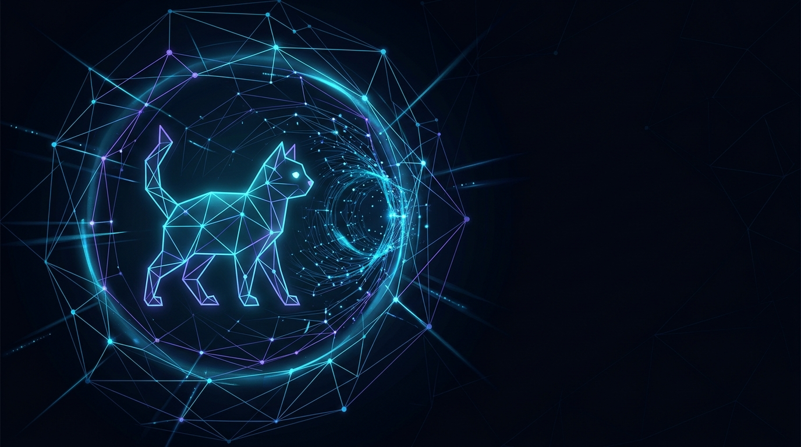
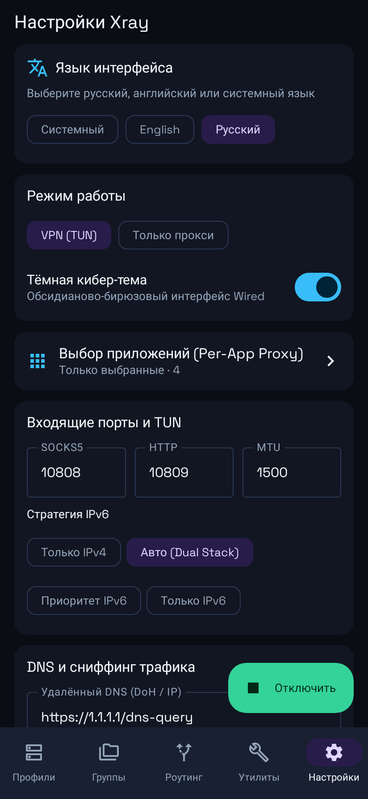

<div align="center">



# NekoXray

**Современный Android-клиент на базе Xray-core (`v26.10.31`) с интерфейсом Jetpack Compose & Material 3**

[English](README.md) · [Русский](README_RU.md)

-3DDC84?style=flat-square&logo=android&logoColor=white)


</div>

---

**NekoXray** — клиент прокси и VPN для Android на **Kotlin**, **Jetpack Compose** и **Material Design 3**, работающий на нативном ядре **Xray-core (`AndroidLibXrayLite` / `libv2ray.aar`)**. Приложение выполнено в тёмной кибер-минималистичной палитре **Wired** и объединяет актуальные транспорты обхода блокировок, SSH-туннелирование, гибкий роутинг и совместимость с форматами NekoBox.

## Основные возможности

- **Протоколы и современные транспорты**
  - **VLESS** с `xtls-rprx-vision`, **REALITY**, **XHTTP (SplitHTTP)** и постквантовым шифрованием **ML-KEM-768** + проверкой `pqv` (ML-DSA-65)
  - **VMess**, **Trojan**, **Shadowsocks (2022)**, **WireGuard**, **SOCKS5**, **HTTP** и **Custom Xray JSON**
  - **SSH-туннелирование** через `mwiede/jsch` со встроенным SOCKS5 TCP и DNS-over-TCP мостом (поддержка пароля, приватного ключа PEM/OpenSSH с парольной фразой и пиннинга публичного ключа сервера)
- **Маршрутизация и выбор приложений (Per-App)**
  - Правила роутинга по доменам (`geosite:`, `domain:`, wildcard), IP/CIDR (`geoip:`), портам и протоколам с действиями `PROXY` / `DIRECT` / `BLOCK`
  - **Per-App Proxy** (`Все приложения`, `Только выбранные`, `Обходить выбранные`) с **копированием и вставкой списка в формате NekoBox** (`false`/`true` в первой строке + ID пакетов)
  - Фрагментация TLS ClientHello (`fragment`), настраиваемые Remote DoH/DNS и Direct DNS, выбор стратегии IPv6
- **Крупные QR-коды и сканер**
  - Векторный **Canvas-генератор QR**, вмещающий длинные ссылки **2200+ символов** (VLESS ML-KEM-768 + `pqv`, до QR v40 с авто-выбором ECC-L) и открывающийся во весь экран по нажатию
  - Встроенный сканер **CameraX + ZXing** с фонариком и выбором скриншотов из галереи через **Android Photo Picker** (без разрешений на доступ к хранилищу)
- **Утилиты REALITY**
  - Генератор ключей **X25519 + UUID + Short ID** с готовым серверным `config.json` в один клик
  - Проверка SNI (**Masquerade SNI Probe**) на поддержку `TLSv1.3` и `HTTP/2`
- **Интерфейс, статистика в шторке и выбор языка**
  - Мгновенное переключение языка в приложении (**Системный**, **English**, **Русский**) без перезапуска и разрыва активного VPN
  - Информативное уведомление со скоростью скачивания/отдачи и объёмом трафика + плитка быстрых настроек (Quick Settings Tile)
  - Адаптивный интерфейс для смартфонов, складных устройств и планшетов (`NavigationBar` / `NavigationRail`)

---

## Скриншоты

<div align="center">

| Профили и узлы REALITY | Роутинг и Per-App Proxy | Генератор ключей и проверка SNI |
| :---: | :---: | :---: |
|  |  |  |

| Настройки и выбор языка | Векторный QR-код для длинных ключей |
| :---: | :---: |
|  |  |

</div>

---

## Архитектура и стек технологий

```text
app/src/main/java/com/example/
├── core/
│   ├── crypto/    # Генератор X25519 REALITY и UUID
│   ├── model/     # Модели профилей, групп, правил роутинга, настроек и языка
│   ├── network/   # Проверка TLSv1.3 SNI, пинг узлов, обновление подписок
│   ├── parser/    # Парсер и экспорт URI (vless/vmess/trojan/ss/wg/ssh/socks/json)
│   ├── vpn/       # XrayVpnService, XrayTileService, SshTunnelBridge, KotlinTunForwarder
│   └── xray/      # XrayConfigBuilder и валидатор конфигурации
├── data/          # Room (KSP), DataStore Preferences, NekoRepository
└── ui/            # Экраны Jetpack Compose M3, Navigation, локализация, тема Wired Cyber
```

- **UI:** Jetpack Compose, Material 3, Navigation Compose (типобезопасные маршруты `@Serializable`)
- **Ядро:** `AndroidLibXrayLite` (`libv2ray.aar` v26.10.31), `mwiede/jsch` для SSH
- **Хранение данных:** Room (KSP) + Jetpack DataStore Preferences
- **Камера и QR:** CameraX `1.5.0` + ZXing `3.5.3` + Android Photo Picker
- **Тесты:** JUnit 4 + Robolectric (модульные тесты + рендеринг UI-скриншотов)

---

## Сборка из исходников

Скрипт `app/build.gradle.kts` автоматически загружает `libv2ray.aar` (`v26.10.31`) на этапе `preBuild`.

```bash
# Сборка debug APK
gradle assembleDebug

# Запуск модульных и Robolectric-тестов
gradle :app:testDebugUnitTest
```
